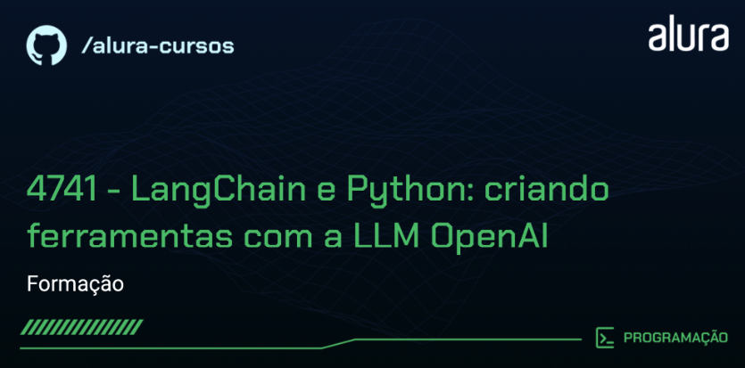

# Estudo de Caso - Sistema de Recomendação de Roteiros de Viagem com RAG

> Estudo de caso com LangChain que implementa um fluxo de **RAG (Retrieval-Augmented Generation)** para responder perguntas sobre os benefícios de viagem, seguros e assistência dos cartões Mastercard (Standard, Gold e Platinum). As respostas do modelo são geradas exclusivamente a partir do conteúdo dos guias de benefícios.

## Como funciona
1. **Carregamento**: os guias de benefícios são lidos a partir de `app/gtb_docs/` (TXT ou PDF).
2. **Chunking**: o texto é dividido em trechos de 1000 caracteres com sobreposição de 100 (`RecursiveCharacterTextSplitter`).
3. **Embeddings**: os trechos são vetorizados com o modelo multilíngue `sentence-transformers/paraphrase-multilingual-MiniLM-L12-v2` (executado localmente via Hugging Face).
4. **Indexação e busca**: os vetores são armazenados em memória com **FAISS**, e os 2 trechos mais relevantes (`k=2`) são recuperados para cada pergunta.
5. **Geração**: a pergunta e o contexto recuperado são enviados ao **Claude** (`claude-haiku-5-5`), instruído a responder usando apenas o conteúdo fornecido.

## Estrutura do projeto
```
.
├── app/
│   ├── gtb_docs/              # Guias de benefícios Mastercard (nov/2023)
│   │   ├── GTB_standard_Nov23.pdf
│   │   ├── GTB_gold_Nov23.pdf
│   │   ├── GTB_gold_Nov23.txt
│   │   └── GTB_platinum_Nov23.pdf
│   └── src/
│       ├── main.py            # RAG sobre o guia Gold em TXT
│       └── main_pdfs.py       # RAG sobre os três guias em PDF
├── assets/
├── pyproject.toml             # Configuração do blue e isort
└── requirements.txt
```

## Pré-requisitos
- Python 3.10+
- Uma chave de API da Anthropic

## Instalação
```bash
python -m venv .venv
source .venv/bin/activate
pip install -r requirements.txt
```

> Na primeira execução, o modelo de embeddings é baixado do Hugging Face, o que pode levar alguns minutos.

## Configuração
Crie um arquivo `.env` na raiz do projeto com a sua chave:
```env
ANTHROPIC_API_KEY=sua_chave_aqui
```

## Execução
Os scripts usam caminhos relativos à raiz do projeto, portanto execute-os a partir dela:

```bash
# Consulta ao guia Gold (TXT)
python app/src/main.py

# Consulta aos guias Standard, Gold e Platinum (PDF)
python app/src/main_pdfs.py
```

As perguntas de exemplo estão no final de cada script; para fazer outras consultas, altere a chamada à função `responder()`.

## Formatação de código
O projeto usa [blue](https://blue.readthedocs.io/) e [isort](https://pycqa.github.io/isort/), configurados no `pyproject.toml`:
```bash
isort .
blue .
```

## Referências
- [Documentação do LangChain](https://docs.langchain.com/oss/python/langchain/overview)
- [Integração LangChain + Anthropic](https://docs.langchain.com/oss/python/integrations/chat/anthropic)
- [FAISS](https://github.com/facebookresearch/faiss)
- [Sentence Transformers](https://www.sbert.net/)
